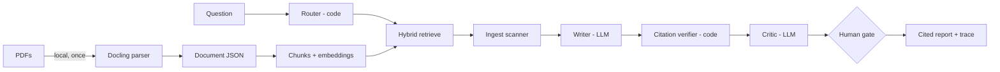

# DocAgent — Document-Aware Multi-Agent Research with Verifiable Citations & Guardrails

> One-line pitch: ask questions over messy documents, get a cited report where every claim is
> machine-verified against the source page, with prompt-injection defenses and a full audit trail.

**Live demo:** _TODO link_ · **Demo video:** _TODO_ · **Runs fully offline & free** with Ollama.

## Results (local, Ollama <model>)
_TODO: paste the table generated by `make eval`_

| Config | Answer acc. | Citation P | Citation R | Unsupported claims | Attack success | Latency |
|---|---|---|---|---|---|---|
| PyPDF + BM25 + single agent | | | | | | |
| Docling + hybrid + loop | | | | | | |
| + critic | | | | | | |
| + guardrails (on vs off) | | | | | | |

Guardrail detection / FPR on N attack + N benign documents: _TODO_

## Architecture

Details: `docs/architecture.md`, `docs/threat_model.md`.

## Quickstart (fully local, free)
```bash
make setup
ollama pull qwen2.5:7b-instruct && ollama pull nomic-embed-text
cp .env.example .env
# put PDFs in data/raw/
make ingest && make index
make ask Q="How long is personal data retained?"
make app
```

## Modes
`ollama` (local) · `api` (free-tier OpenAI-compatible) · `replay` (cached traces)

## Limitations
_TODO: be honest — where it fails, model-size limits, OCR quality, small gold set._
